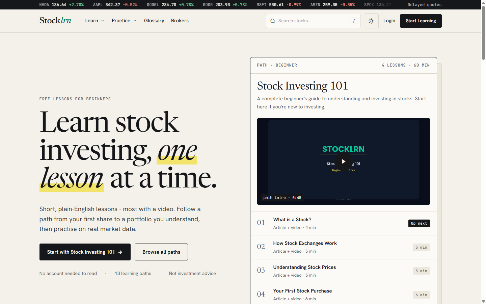

# StockLrn

**Stock market lessons for beginners, built on real market data with interactive charts and flashcard drills.**

[stocklrn.com](https://stocklrn.com) · [Case study](https://agicad.com/portfolio/stocklrn/)

> The source code is private. This repository documents the product and how it is built.

## The problem

A data-heavy education site can fail in two ways that look the same to visitors: it is slow, or its data is stale. Calling a market-data API while rendering a page causes both problems, and it makes costs grow with crawler traffic. With many page types there is a third problem: visual inconsistency builds up fast.

## How it's built

- **No external calls while rendering.** Market data arrives only through explicit refresh and ingest jobs. Read paths are cached, and every sorted or filtered column is indexed. Profiling confirmed there are no N+1 loops.
- **Design system.** CSS custom-property tokens and a named component layer replaced stray hex values and one-off utilities. A palette change is now a one-file edit. The CSS bundle shrank, and axe-core reports zero accessibility violations.
- **Automated video pipeline.** A scheduled job generates the script, runs text-to-speech, assembles the video and publishes it. A tiered LLM client falls through to the next provider when one fails.
- **Loud failure on cost.** Scheduled jobs refuse paid model slugs. If a provider withdraws a free tier, the job fails loudly instead of quietly running up charges.
- **Reproducible curriculum.** Versioned seeder classes load the lessons and quizzes, so the content can be rebuilt from code.

## Stack

PHP 8.2+, Laravel, Blade, Vue.js, Alpine.js, ApexCharts, Tailwind CSS, MySQL.

## Author

Built and run by [Toni Ilić](https://github.com/toniilic). I take on side projects through [AgiCAD](https://agicad.com).
